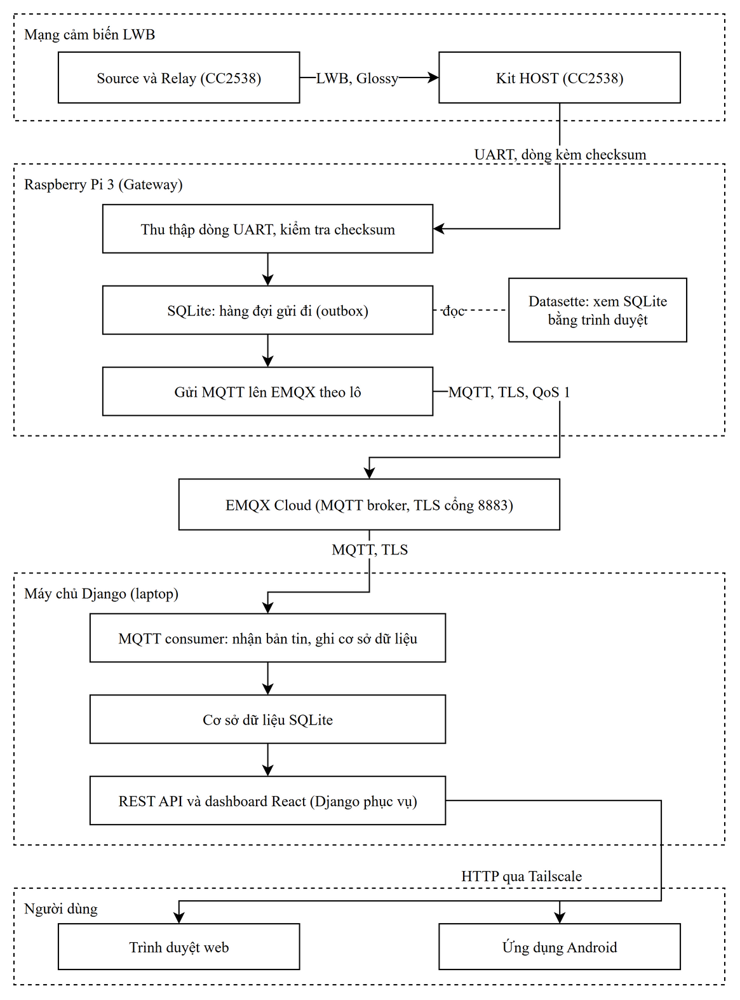

# Giám sát môi trường bằng mạng cảm biến không dây LWB/Glossy (CC2538)

Mã nguồn đi kèm đồ án tốt nghiệp: mạng cảm biến không dây công suất thấp dùng **Glossy** (lan truyền
flood đồng bộ) và **LWB** (Low-power Wireless Bus) trên Contiki/CC2538, thu thập nhiệt độ, độ ẩm, ánh sáng,
áp suất; dữ liệu đi qua gateway (Raspberry Pi) → MQTT/EMQX → backend Django → dashboard web và ứng dụng di động.

## Kiến trúc



Node cảm biến (SOURCE) → relay → HOST (CC2538 nối UART) → `gateway` (đọc UART, lưu SQLite, publish MQTT)
→ broker EMQX → `backend` (consumer lưu DB, REST API, dashboard) → `mobileapp` (Flutter, gọi API).

## Cấu trúc thư mục

| Thư mục | Vai trò | Tài liệu |
|---|---|---|
| [lwb-cc2538dk/](lwb-cc2538dk/) | Firmware Contiki cho CC2538DK: `net/glossy`, `net/lwb`, ứng dụng `apps/lwb-cc2538dk-env` (cảm biến, OLED, gói perf), công cụ phân tích log, kiểm chứng | [README_VI.md](lwb-cc2538dk/README_VI.md), [VALIDATION.md](lwb-cc2538dk/VALIDATION.md) |
| [gateway/lwb_source/](gateway/lwb_source/) | Gateway trên Raspberry Pi: đọc UART, SQLite, publish MQTT, xuất CSV, service systemd | [README.md](gateway/lwb_source/README.md) |
| [backend/](backend/) | Backend Django (MQTT consumer, REST API, API mobile `/api/mobile/v1`), frontend React, Docker Compose | [README.md](backend/README.md), [README_WINDOWS.md](backend/README_WINDOWS.md) |
| [analysis/](analysis/) | Log UART gốc của các phiên đo (`analysis/logs/`, 18 file) và script phân tích: `analyze_runs.py` (sinh `out/sessions.csv`, `out/per_source.csv`), `make_report.py` (hình, cần matplotlib), `build_summary.py` (`out/SUMMARY.md`) | [out/SUMMARY.md](analysis/out/SUMMARY.md) |
| [mobileapp/lwb_mobile/](mobileapp/lwb_mobile/) | Ứng dụng Flutter xem dữ liệu node | [README.md](mobileapp/lwb_mobile/README.md) |
| [mobileapp/lwb_setup/](mobileapp/lwb_setup/) | Gói cài đặt/đối chiếu bản mobile + API (script PowerShell, self-test) | [README.md](mobileapp/lwb_setup/LWB_Mobile/README.md) |

## Yêu cầu môi trường

- Firmware: Contiki (cây mã `$HOME/contiki`), toolchain `arm-none-eabi-gcc`, kit CC2538DK.
- Gateway: Raspberry Pi (Python 3), cổng `/dev/ttyUSB0`, thư viện trong `gateway/lwb_source/requirements.txt`.
- Backend: Python 3 + `requirements.txt` (hoặc Docker), PostgreSQL/SQLite, broker MQTT (EMQX). Frontend đã build sẵn trong `backend/frontend/dist/`, nên chạy backend không cần Node.js; Node.js chỉ cần khi sửa giao diện.
- Mobile: Flutter SDK, Android Studio/emulator.

## Hướng dẫn nhanh

1. **Build firmware** (chi tiết và các cờ build trong `lwb-cc2538dk/README_VI.md`):
   ```bash
   cd lwb-cc2538dk/apps/lwb-cc2538dk-env
   make clean TARGET=cc2538dk CONTIKI="$HOME/contiki"
   make TARGET=cc2538dk CONTIKI="$HOME/contiki" NODEID=3 ROLE=2 HOST_ID=1
   ```
2. **Chạy gateway**: sao chép `gateway/lwb_source/gateway.env.example` thành file env riêng, điền thông tin broker,
   rồi làm theo `gateway/lwb_source/README.md` (service systemd `lwb-gateway`, `lwb-mqtt`).
3. **Chạy backend**: `cd backend`, sao chép `.env.example` thành `.env` (đặt `DJANGO_SECRET_KEY`, thông tin MQTT/DB riêng),
   rồi `docker compose up -d --build` hoặc theo `README_WINDOWS.md`. Sửa giao diện thì chạy `npm run build` trong `backend/frontend`
   (cập nhật lại `dist/`).
4. **Build app**: `cd mobileapp/lwb_mobile && flutter pub get && flutter run` (địa chỉ backend nhập trong app).
5. **Phân tích log đo**: `cd analysis && python analyze_runs.py` (chỉ cần thư viện chuẩn của Python), rồi `python make_report.py` và
   `python build_summary.py` nếu cần hình và `SUMMARY.md` (cần `matplotlib`). Script chỉ đọc `analysis/logs/`, không sửa log gốc.

> Không commit `.env`, khóa hay cơ sở dữ liệu. Log UART trong `analysis/logs/` là dữ liệu đo thô của đồ án (không chứa thông tin đăng nhập).
> Các giá trị mật khẩu và tên broker trong repo chỉ là placeholder.

## Bản quyền và trích dẫn

- **Giấy phép MIT** (file [LICENSE](LICENSE), © 2026 Phan Vinh Chuong) chỉ áp dụng cho phần do tác giả đồ án viết
  (đồng pha tạo gói, `relay_cnt`, thống kê hiệu năng, ứng dụng firmware, gateway, backend, app di động, tài liệu).
- `lwb-cc2538dk/net/lwb` và `lwb-cc2538dk/net/glossy` kế thừa từ dự án **lwb-cc2538** của Kasun Hewage và **giữ giấy phép
  BSD 3-Clause** của K. Hewage ([lwb-cc2538dk/LICENSE](lwb-cc2538dk/LICENSE)); giữ nguyên thông báo bản quyền trong từng file.
- Trích dẫn:
  - F. Ferrari, M. Zimmerling, L. Thiele, O. Saukh, "Efficient Network Flooding and Time Synchronization with Glossy," IPSN 2011.
  - F. Ferrari, M. Zimmerling, L. Mottola, L. Thiele, "Low-Power Wireless Bus," SenSys 2012.

## English summary

Graduation-thesis code for an environmental-monitoring wireless sensor network built on Glossy and the Low-Power
Wireless Bus (LWB) for Contiki on the TI CC2538. Folders: `lwb-cc2538dk` (firmware), `gateway` (Raspberry Pi UART→MQTT bridge),
`backend` (Django + React dashboard + mobile API), `mobileapp` (Flutter). Copy the `*.env.example` files to local `.env` files and
fill in your own broker/database credentials; no secrets are stored in this repository. `net/lwb` and `net/glossy` derive from
K. Hewage's lwb-cc2538 (BSD-3-Clause, notices retained). The repository is MIT-licensed (c) 2026 Phan Vinh Chuong, except `net/lwb` and `net/glossy`, which stay under Hewage's BSD-3-Clause.
